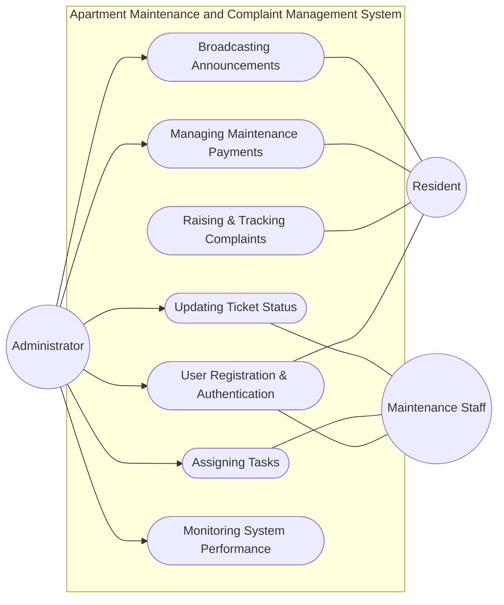

# APARTMENT MAINTENANCE & COMPLAINT MANAGEMENT SYSTEM
      
### 23CS31ME – MINI CAPSTONE PROJECT
 
Submitted by 

**RAM PRASATH M** (2312063)
 
In partial fulfillment for the award of the degree of 
**BACHELOR OF ENGINEERING** 
in 
**COMPUTER SCIENCE AND ENGINEERING** 
 
**NATIONAL ENGINEERING COLLEGE** 
(An Autonomous Institution affiliated to Anna University, Chennai) 
K.R.NAGAR, KOVILPATTI - 628503 
APRIL - 2025 

---
 
### NATIONAL ENGINEERING COLLEGE 
(An Autonomous Institution affiliated to Anna University, Chennai) 
K.R.NAGAR, KOVILPATTI - 628503 
 
### BONAFIDE CERTIFICATE 
 
This is to certify that this project report, “**Apartment Maintenance & Complaint Management System**”, is the bonafide work of **RAM PRASATH M (2312063)** who carried out the project work under my supervision. 
 
Course Instructor/Guide 

Submitted to the 23CS1ME - MINI CAPSTONE PROJECT Viva-Voce examination held at National Engineering College, K.R.Nagar, Kovilpatti on ____________.
 	 
Internal Examiner                Co-Examiner 

---

## ABSTRACT

The rapid urbanization and proliferation of large-scale residential complexes have fundamentally shifted the paradigm of community living. As gated communities expand, the administrative overhead required to manage day-to-day operations—ranging from financial accounting to facility maintenance—has grown exponentially. The Apartment Maintenance & Complaint Management System is an enterprise-grade, full‑stack web application developed to digitalize, streamline, and optimize these complex administrative workflows. Traditional society management methods remain heavily reliant on manual registers, fragmented chat groups, and cash or unverified digital transactions. This leads to severe operational bottlenecks: untracked complaints, missed maintenance payments, delayed resolutions, and a profound communication gap between residents and the management committee.

This project directly addresses these challenges by introducing a centralized, role‑based platform that acts as a unified hub for the complete lifecycle of apartment administration. Built on the highly scalable MERN stack (MongoDB, Express.js, React, Node.js), the platform features robust RESTful APIs and optimized database models. The architecture goes beyond standard CRUD operations by incorporating advanced modern integrations: secure JSON Web Token (JWT) based authentication, real-time bi-directional communication via Socket.io, an automated integrated payment gateway (Razorpay) for maintenance dues, scheduled background tasks using node-cron, and cloud-based media processing via Cloudinary for complaint attachments. Additionally, the frontend utilizes Vite for lightning-fast bundling, Tailwind CSS for a premium user interface, Framer Motion for fluid animations, and Recharts for dynamic visual analytics.

The system is strictly role-based, providing tailored interfaces for End-Users (Residents), Service Providers (Maintenance Staff), and Administrators (Society Managers). It bridges the operational gaps by automating ticket routing, enforcing financial accountability, generating automated PDF invoices via jsPDF, and providing multilingual support via i18next. 

This project demonstrates how cutting-edge web technologies can be effectively applied to mitigate real‑world administrative friction. The resulting system dramatically improves financial transparency, enhances staff accountability, reduces manual administrative friction, and cultivates a harmonious, well-managed living environment. It is highly scalable, easily maintainable, and designed as a perfect fit for modern residential complexes and housing societies of any scale.

---

## TABLE OF CONTENTS 
 
| CHAPTER NO. | TITLE | PAGE NO. |
|---|---|---|
| | ABSTRACT | iv |
| | LIST OF FIGURES | vii |
| **1.** | **INTRODUCTION** | **1** |
| | 1.1 BACKGROUND | 1 |
| | 1.2 PROBLEM STATEMENT | 2 |
| | 1.3 OBJECTIVES | 3 |
| | 1.4 SCOPE | 4 |
| | 1.5 SIGNIFICANCE | 5 |
| **2.** | **LITERATURE SURVEY** | **6** |
| **3.** | **DESIGN THINKING** | **9** |
| | 3.1 EMPATHY MAPPING & USER RESEARCH | 9 |
| | 3.2 PERSONA 1 - THE RESIDENT | 10 |
| | 3.3 PERSONA 2 - THE MAINTENANCE STAFF | 11 |
| | 3.4 PERSONA 3 - THE ADMINISTRATOR | 12 |
| | 3.5 USER JOURNEY MAPPING | 13 |
| **4.** | **PROPOSED METHODOLOGY** | **15** |
| | 4.1 EXISTING WORK AND ITS LIMITATIONS | 15 |
| | 4.2 PROPOSED WORK AND ALGORITHMIC FLOW | 16 |
| | 4.3 SYSTEM DESIGN | 18 |
| | 4.3.1 Detailed Use Case Descriptions | 18 |
| | 4.4 SYSTEM ARCHITECTURE | 20 |
| | 4.4.1 Three-Tier Architecture Breakdown | 21 |
| | 4.5 MODULES | 22 |
| | 4.6 SYSTEM REQUIREMENTS | 27 |
| | 4.6.1 Development Environment & IDE | 27 |
| | 4.6.2 Backend Infrastructure | 27 |
| | 4.6.3 Database Infrastructure | 28 |
| | 4.6.4 Frontend Infrastructure | 28 |
| | 4.6.5 Third-Party APIs and Libraries | 29 |
| **5.** | **IMPLEMENTATION AND RESULT** | **31** |
| | 5.1 IMPLEMENTATION PHASES | 31 |
| | 5.1.1 Phase 1: Environment & Database Modeling | 31 |
| | 5.1.2 Phase 2: Secure API Development | 32 |
| | 5.1.3 Phase 3: Frontend UI/UX Construction | 33 |
| | 5.1.4 Phase 4: Integrations (Payments & Cloud) | 34 |
| | 5.1.5 Phase 5: Real-time Engine & Optimization | 35 |
| | 5.2 RESULTS & INTERFACE SHOWCASE | 36 |
| **6.** | **CONCLUSION AND FUTURE SCOPE** | **42** |
| | 6.1 CONCLUSION | 42 |
| | 6.2 FUTURE SCOPE | 44 |
| | **REFERENCES** | **46** |

---

## CHAPTER 1 
## INTRODUCTION 
 
### 1.1 Background
The landscape of urban housing has transformed drastically over the past two decades. With land scarcity in metropolitan areas, independent houses have largely been replaced by high-rise apartment complexes and vast gated communities. These modern mega-structures are akin to micro-cities; they contain hundreds of residential units, shared community halls, swimming pools, gymnasiums, and extensive plumbing and electrical grids. Consequently, managing such a facility is an operation of massive scale. It requires dedicated committees—often known as Resident Welfare Associations (RWAs)—to oversee facility maintenance, security, and financial administration.

Traditionally, the operation of these societies is handled manually. Facility managers use physical ledgers to track who has paid their monthly maintenance fees. Maintenance schedules are written on whiteboards, and urgent notices are printed on paper and pinned to notice boards in elevators. In recent years, managers have attempted to digitize workflows using instant messaging applications like WhatsApp and basic spreadsheet software like Microsoft Excel. 
However, as a society scales beyond 50+ units, these rudimentary tools become catastrophic points of failure. Messages get buried in chaotic group chats, spreadsheets become desynchronized between different administrative staff, and residents are left entirely in the dark regarding the utilization of their financial contributions. 

A centralized, automated, and digital-first approach to apartment management is no longer a luxury but an absolute necessity to maintain operational harmony, financial integrity, and a premium quality of life for residents.

### 1.2 Problem Statement
The current methodologies for managing medium-to-large residential complexes are fundamentally flawed due to extreme fragmentation. This disconnect results in a multitude of critical problems:

1. **Financial Discrepancies and Lack of Transparency:** Collecting monthly maintenance dues via varied methods (cash, checks, direct bank transfers, UPI) without a centralized ledger leads to massive accounting errors. Residents frequently complain about being charged late fees incorrectly because their manual payments were not recorded in time by the office staff.
2. **Loss of Service Requests (Complaints):** When complaints are registered verbally at the security desk or via a chaotic WhatsApp group, they lack formal tracking. There is no concept of a Service Level Agreement (SLA). Severe problems like water leaks or electrical faults are often delayed, causing structural damage and extreme resident dissatisfaction.
3. **Communication Silos:** Crucial announcements (e.g., scheduled power cuts, water tank cleaning, emergency meetings) often fail to reach all residents. Physical notices are easily missed, and emails are often ignored.
4. **Poor Staff Accountability:** There is no systemic way to track the efficiency of maintenance personnel (plumbers, electricians, janitors). Admins cannot verify if a task took 2 hours or 2 days, leading to inefficient payroll expenditure.
5. **Data Security Risks:** Utilizing physical registers for resident data compromises privacy and runs the risk of total data loss in case of physical damage (fire, misplacement).

### 1.3 Objectives
To systematically eradicate the problems stemming from manual administration, this project establishes the following comprehensive objectives:

- **Centralized Ecosystem:** To architect a singular, secure web-based platform serving as the sole source of truth for all society operations.
- **Role-Based Access Control (RBAC):** To implement strict access tiers, ensuring residents see only their personal data, staff see only their assigned tasks, and admins command the overarching dashboard.
- **Automated Financial Tracking:** To integrate a secure payment gateway (Razorpay) that handles transactions effortlessly, automatically updates the user's ledger, and instantly generates downloadable PDF invoices/receipts.
- **End-to-End Complaint Lifecycle Management:** To build a robust ticketing system allowing residents to describe issues, attach photographic evidence (via Cloudinary), track real-time status updates, and allow staff to mark issues as "Resolved".
- **Real-Time Synchronized Communication:** To utilize WebSocket technology (Socket.io) to push instant notifications directly to connected users regarding payment updates, complaint status changes, and critical admin announcements, bypassing the delays of traditional email.
- **Automated Penalties and Scheduling:** To implement background chron-jobs (node-cron) that automatically calculate and append late-payment penalties to defaulting resident accounts on the 1st of every month without manual intervention.
- **Visual Analytics:** To provide the management committee with a rich dashboard featuring dynamic charts representing financial health, complaint resolution speeds, and resident engagement.

### 1.4 Scope
The Apartment Maintenance System is a strictly bounded, highly focused enterprise application. 

**In-Scope:**
- Complete User Authentication and Profile Management (encrypted storage, tokenized sessions).
- Financial ledger management (monthly dues generation, Razorpay integration, automated receipt generation via jsPDF).
- Complaint ticketing (media uploads via Multer/Cloudinary, assignment algorithms, status tracking).
- Digital Notice Board and real-time push notifications.
- Admin dashboard with visual data representation (Recharts).
- Multilingual interface support via i18next to cater to diverse demographic residents.

**Out-of-Scope:**
- Physical hardware integrations (e.g., Boom barriers, RFID tags, smart water meters).
- Visitor Management / Gate Security (tracking delivery applications or guest entry algorithms), which requires a separate module dedicated to security personnel.

### 1.5 Significance
The significance of this automated system lies in its ability to transform chaos into structured transparency. By digitizing financial ledgers, it mathematically guarantees trust between residents and the management. It drastically reduces the manual labor hours spent by society managers on accounting and follow-ups. By automating the ticket routing process, the turnaround time for critical facility repairs is vastly accelerated, directly preserving the property value of the complex. Ultimately, it elevates the standard of living by providing a modern, frictionless, "smart-society" experience that residents increasingly expect in the modern digital era.

---

## CHAPTER 2 
## LITERATURE REVIEW 

The domain of property and facility management has evolved through several distinct paradigms over the last few decades. Understanding this evolution is crucial to identify where existing systems fall short and how the proposed MERN-stack architecture provides an optimal solution.

**Phase 1: The Era of Physical Ledgers (Pre-2005)**
Historically, property management was an entirely analog process. Resident Welfare Associations operated out of small physical offices containing dozens of physical registers. There was a 'Payment Register', a 'Complaint Book', and a 'Visitor Log'. 
*Drawbacks:* These systems were susceptible to human error, physical degradation, and data loss. Resolving a payment dispute often meant spending hours manually searching through hundreds of handwritten pages. Transparency was essentially non-existent.

**Phase 2: Spreadsheet and Disjointed Desktop Software (2005 - 2015)**
With the advent of affordable computing, management committees transitioned to Microsoft Excel or standalone, offline desktop software (often built on visual basic and MS Access). While this allowed for basic tabular organization and searchability, it was strictly localized.
*Drawbacks:* These systems lacked interconnectivity. Data resided on a single local computer in the manager's office. Residents still had no direct access to their data and had to visit the office during working hours. There was no real-time capability or remote access. 

**Phase 3: Web-Based Bulletin Boards and Fragmented Digital Communication (2015 - 2020)**
As the internet became ubiquitous, RWAs began employing basic web portals. However, these were mostly static websites acting as digital bulletin boards. Concurrently, the explosion of smartphone applications like WhatsApp and Telegram led communities to rely on group chats for daily operations.
*Drawbacks:* While communication speed increased, data structure collapsed. Important financial notices were buried under hundreds of daily casual messages in group chats. When a resident sent a photo of a broken pipe on WhatsApp, it was easily forgotten by the next day. A fundamental principle of software engineering was violated: data was unstructured, unsearchable, and untrackable.

**Phase 4: Modern Enterprise SaaS Platforms (Present)**
In recent years, highly capitalized tech startups have introduced comprehensive SaaS (Software as a Service) platforms like MyGate, NoBrokerHood, and Adda. These platforms offer end-to-end solutions including visitor management, finance, and security.
*Drawbacks:* While highly functional, these platforms are designed as massive monolithic services that are notoriously expensive. For a mid-sized apartment complex (50-200 units), the monthly subscription fees for these enterprise tools are often financially unviable. Furthermore, because they are centralized third-party platforms, data sovereignty is an issue—societies do not own the database containing their financial records.

**The Proposed System: A Tailored, Agile MERN Solution**
The literature review indicates a gaping void in the market: mid-sized and independent residential communities desperately need the robust architecture of enterprise systems, but without the bloated costs and privacy concerns of massive third-party platforms. 

The proposed *Apartment Maintenance & Complaint Management System* is engineered to fill this exact gap. By utilizing modern JavaScript frameworks (React and Node.js), scalable NoSQL databases (MongoDB), and micro-transaction gateways (Razorpay), the system delivers an enterprise-grade, real-time experience tailored specifically for the community. The system maintains data sovereignty, drastically cuts overhead costs, and employs WebSocket technology to provide the real-time responsiveness that residents expect from modern mobile applications.

---

## CHAPTER 3 
## DESIGN THINKING

### 3.1 Empathy Mapping & User Research
Software utility is directly proportional to its alignment with user psychology and daily workflows. Design thinking was deeply integrated into the preliminary phases of this project. Empathy mapping was conducted to document the precise needs, operational pain points, motivations, and technological proficiency of the three primary user groups interacting with the system.

### 3.2 Persona 1 - The Resident (End-User)
**Profile:** Tech-savvy professionals living in the complex. They expect seamless digital experiences similar to Swiggy or Uber. They have limited time to deal with administrative friction.

**Says:**
•	"I transferred the maintenance fee via NEFT two days ago, but I’m still showing as a defaulter on the notice board."
•	"The seepage in my ceiling is expanding. I complained to the security guard yesterday, but nobody has come to check it."

**Thinks:**
•	"Where exactly is the maintenance money being utilized?"
•	"Why can't I just pay this with two taps on my phone and get an instant digital receipt?"

**Does:**
•	Has to physically walk down to the management office to argue about unrecognized payments.
•	Scrolls through hundreds of irrelevant WhatsApp messages to find the PDF of the recent society meeting minutes.

**Feels:**
•	Extreme frustration when promised amenities (gym, pool) are closed for maintenance without prior digital notification.
•	Anxious when severe apartment issues (leaks, electrical faults) are ignored by management.

**Pain Points:** Lack of transparency in complaint tracking; manual, stressful payment verification processes; missing critical announcements amidst communication noise.

**Systemic Solution Required:** A clean dashboard providing one-click Razorpay checkout, a visual tracker for complaint SLAs, and push notifications for immediate priority updates.

### 3.3 Persona 2 - The Maintenance Staff (Service Provider)
**Profile:** Plumbers, electricians, and janitors. Often less digitally literate, requiring highly visual, simple, and straightforward User Interfaces. 

**Says:**
•	"The manager gave me a verbal list of 5 apartments to visit. I forgot the flat number for the plumbing issue."
•	"I went to Flat 402 to fix the AC, but the resident had gone to work. Now the manager thinks I skipped the job."

**Thinks:**
•	"It would be much easier if I just had a list on my mobile phone telling me exactly where to go."
•	"How do I prove to the manager that I actually completed the repair looking exactly the way it should?"

**Does:**
•	Relies on the admin's daily handwritten list or printed excel sheets.
•	Spends significant time walking back and forth to the central office to update job statuses verbally.

**Feels:**
•	Overworked when multiple dispatch instructions are chaotic and unorganized.
•	Satisfied and efficient when they can sequentially check off tasks without supervision.

**Pain Points:** Lost or forgotten complaints, miscommunication regarding resident availability, lack of formal proof of job completion.

**Systemic Solution Required:** A mobile-responsive web view showing a clear, prioritized checklist of tasks, featuring buttons to upload a 'job finished' photograph, and instant status toggles (In Progress -> Resolved).

### 3.4 Persona 3 - The Administrator / Society Manager
**Profile:** The management committee members. Often overwhelmed by paperwork, phone calls, and resident disputes. Requires high-level analytical tools.

**Says:**
•	"I spend the first ten days of every month manually matching bank statements against resident UPI screenshots to clear their dues."
•	"A resident is threatening legal action because a balcony repair was allegedly ignored for two months, but I have no record of their complaint."

**Thinks:**
•	"I need an automated way to penalize late payers; calculating 5% late fees manually for 200 flats is a nightmare."
•	"How can I ensure every resident is legally notified about the upcoming emergency structural audit?"

**Does:**
•	Manually reconciles complex accounting books.
•	Fields angry phone calls daily regarding pending repairs and facility downtimes.

**Feels:**
•	Stressed and overwhelmed by the sheer volume of unstructured, multi-channel data.
•	Empowered when holding a definitive, unarguable digital ledger of all operations.

**Pain Points:** Endless manual financial tracking, scattered communication channels, absolute lack of data analytics and staff performance auditing.

**Systemic Solution Required:** A master dashboard rendering visual charts of financial adherence, automated billing cycles via cron-jobs, and a mass-broadcasting tool for society-wide announcements.

### 3.5 User Journey Mapping
To synthesize the design thinking, the system was architecture around idealized user journeys:
1. **The Complaint Lifecycle:** Resident snaps a photo of a broken pipe -> Uploads via App -> System logs timestamp and alerts Admin via Socket.io -> Admin assigns ticket to Plumber -> Plumber sees ticket on their UI, fixes pipe, uploads resolution photo -> Resident is instantly notified via push notification that the issue is closed.
2. **The Financial Lifecycle:** 1st of the Month -> `node-cron` automatically generates invoices for all active flats -> Resident receives Email & App notification -> Resident clicks "Pay Now" -> Razorpay processes transaction -> Webhook confirms payment to Node Server -> Database marks ledger as 'Paid' -> Resident instantly receives a downloadable PDF receipt.

---

## CHAPTER 4
## PROPOSED METHODOLOGY

### 4.1 Existing Work and its Limitations
Before engineering the solution, an analysis of the existing operational baselines in average housing societies was conducted.

**The Core Baseline:** Most complexes utilize Microsoft Excel for logging maintenance fees and a localized WhatsApp Group named "Society Updates" for communication.
**Limitations Identified:**
- **Concurrency Issues:** An Excel sheet cannot be securely accessed or modified by multiple users simultaneously without enterprise-level tooling (like SharePoint). 
- **Data Mutation:** There is no strict schema in an Excel sheet. A user typing a string instead of an integer in a financial column corrupts downstream reporting.
- **Asymmetric Information:** The WhatsApp approach leads to asymmetric information distribution. New residents joining the group cannot see historical financial decisions or past notices.
- **High Latency in Ticketing:** Verbal or paper-based complaints have an extremely high latency from the time of report to the time of dispatch, leading to resource wastage.

### 4.2 Proposed Work and Algorithmic Flow
The proposed work replaces the fragmented baseline with a unified, state-of-the-art Web Application. The methodology shifts the paradigm from manual 'Pull' processing (admin pulling data from bank statements) to automated 'Push' processing (system pushing data to admin via webhooks).

**Algorithmic Workflows Designed:**
1. **Automated Billing Algorithm:** A cron job evaluates the database at 00:01 AM on the 1st of every month. For every registered user `U`, if `U.isActive`, generate an `Invoice` document with amount `X`. If previous `Invoice` is unpaid, apply `Penalty%` to `X`.
2. **Event-Driven Communication:** Instead of polling the server every minute to check if a complaint is updated, the system uses an event-driven WebSocket architecture. When a state mutates (e.g., Complaint moves from 'Pending' to 'Resolved'), the server actively emits a socket event `TICKET_UPDATED` directly to the specific connected client, forcing an instant React state re-render.
3. **Secure Transaction Verification:** To prevent tampering with payment endpoints, the system utilizes Razorpay signatures. When a payment succeeds, the frontend does not directly tell the database "I paid". Instead, Razorpay sends a secure, hashed webhook to the Node.js server. The server verifies the cryptographic signature before finalizing the ledger.

### 4.3 System Design
The system design was formalized using UML standard Use Case Diagrams to map out actor interactions definitively.

#### 4.3.1 Detailed Use Case Descriptions

**Actor: Resident**
- **UC1: Register & Authenticate:** Resident creates an account linked to a specific Flat Number. Secures access via JWT.
- **UC2: Raise Complaint:** Resident inputs a title, description, category (e.g., Plumbing, Electrical, Civil), and attaches image evidence.
- **UC3: Track Status:** Resident views a kanban-style list of their complaints dynamically updating from Pending -> Assigned -> In Progress -> Resolved.
- **UC4: Pay Dues:** Resident views pending invoices, initiates the Razorpay modal, completes the transaction, and downloads the jsPDF generated receipt.

**Actor: Admin**
- **UC5: Master Dashboard View:** Admin views aggregated Recharts data (Total Collections, Pending Dues, Open Complaints).
- **UC6: Dispatch Assignments:** Admin views all incoming complaints and assigns a specific database relationship to a registered Maintenance Staff member.
- **UC7: Broadcast Notice:** Admin composes a rich-text announcement. The system broadcasts this to all connected sockets and triggers Nodemailer to email offline residents.
- **UC8: User Management:** Admin can approve new resident registrations, ensuring only verified owners/tenants enter the digital ecosystem.

**Actor: Maintenance Staff**
- **UC9: View Assigned Tasks:** Staff logs into a simplified mobile-view showing only tasks assigned to their specific ID.
- **UC10: Update Ticket Status:** Staff can modify the status of the task and provide a closure comment or completion photo.

### 4.4 SYSTEM ARCHITECTURE
The project leverages a robust Three-Tiered Client-Server Architecture, maximizing modularity, security, and scalability.

#### 4.4.1 Three-Tier Architecture Breakdown
1. **The Presentation Tier (Client Interface)**
   - **Framework:** React.js initialized via Vite. 
   - **Role:** Handles the User Interface and highly dynamic User Experience. It maintains local state using React Hooks (`useState`, `useContext`) and manages complex client-side routing via React Router DOM.
   - **UI Libraries:** Tailwind CSS acts as the utility-first styling engine, ensuring absolute responsiveness across all device sizes (mobile, tablet, desktop). Framer Motion provides liquid-smooth page transitions, enhancing the premium feel of the application.
   - **Data Visualization:** Recharts takes JSON arrays of financial data and renders interactive, responsive SVG graphs on the admin dashboard.

2. **The Logic/Application Tier (Server API)**
   - **Framework:** Node.js environment utilizing the Express.js framework.
   - **Role:** Acts as the brain of the application. It exposes RESTful API endpoints (`/api/users`, `/api/complaints`, `/api/payments`). It strictly enforces business logic, sanitizes incoming `express-validator` data, and protects routes utilizing JWT middleware.
   - **Real-Time Engine:** A Socket.io instance runs bound to the HTTP server, managing a live pool of connected user websockets for instant data propagation.
   - **External Hooks:** Interfaces with Cloudinary API for offloading heavy image assets, and Razorpay API to generate transaction orders.

3. **The Data Tier (Database)**
   - **Framework:** MongoDB, a NoSQL Document Database, interfaced via the Mongoose Object Data Modeling (ODM) library.
   - **Role:** Provides persistent, scalable storage. The NoSQL nature allows for highly flexible schema designs, which is crucial when dealing with complex, deeply nested objects like transaction metadata and varied complaint structures.

### 4.5 MODULES
The application is logically segmented into five core operational modules.

**1. Authentication & Role Management Module**
Security is paramount in a system handling residential data and financial transactions. 
- **Encryption:** Passwords are never stored in plaintext. They are salted and hashed using `bcryptjs` before insertion into the database.
- **Session Handling:** Upon successful login, the server signs a JSON Web Token (JWT) containing the user's ID and Role. This token is securely transmitted and stored.
- **Middleware Protection:** Express middleware intercepts every API request. It verifies the validity of the JWT token. If a 'Resident' attempts to access an endpoint mapped to `adminController.js`, the middleware rejects the request with a `403 Forbidden` status.

**2. Complaint & Service Ticketing Module**
This module replaces the chaotic WhatsApp messages with a formalized ticketing system.
- **Schema:** A Complaint document stores: Title, Description, Category, ImageURL, ResidentReference, AssignedStaffReference, Status (Enum), and an array of StatusHistory timestamps.
- **Media Handling:** When a user uploads a photo of an issue, `multer` intercepts the multi-part form data. The image is processed in-memory (optional resizing via `sharp`) and uploaded to a Cloudinary storage bucket. Cloudinary returns a secure URL which is then saved to the MongoDB Complaint document. This keeps the database incredibly lightweight.
- **Real-Time Tracking:** Any mutation to a ticket (e.g., admin assigning it to a plumber) triggers a database save hook, which subsequently commands Socket.io to emit an update event to the resident.

**3. Billing, Finance & Payment Module**
This module eradicates the manual accounting headache for the admin.
- **Automated Invoicing:** Utilizing `node-cron`, a background task runs on the scheduled billing date. It iterates over all active flat units and creates a 'Pending' Invoice document.
- **Razorpay Integration Flow:** 
   1. Resident clicks 'Pay'. React requests the Node server to create an order.
   2. Node server calls Razorpay API: `razorpay.orders.create()`.
   3. Razorpay returns an `order_id` which is sent back to React.
   4. React opens the Razorpay checkout overlay. User completes payment via UPI/Card.
   5. Razorpay sends a background webhook to the Node server with payment signatures.
   6. Node server cryptographically validates the signature. If valid, the Invoice document is updated to 'Paid' status.
- **Receipt Generation:** Utilizing `jspdf` and `html2canvas` on the client side, the application converts the confirmed transaction data into an automated, downloadable PDF receipt bearing the society's letterhead.

**4. Notice Board & Announcements Module**
Ensures 100% communication penetration within the residential complex.
- **Dual-Layered Delivery:** When the admin posts a critical notice (e.g., "Elevator under maintenance"), the server executes a dual delivery strategy.
   - *Layer 1 (Live):* Socket.io broadcasts the notice payload to all currently connected clients, triggering a real-time sliding toast notification (via `react-hot-toast`).
   - *Layer 2 (Persistent):* The server formats a professional HTML email template and utilizes `Nodemailer` to dispatch the announcement to the registered email addresses of all users, ensuring offline residents are also informed immediately.

**5. Executive Dashboard & Analytics Module**
Provides vital intelligence to the society management committee.
- **Data Aggregation:** The Node server performs heavy MongoDB Aggregation pipelines (`$match`, `$group`, `$sum`) to compile complex statistics without overloading the client. It calculates metrics like 'Total Funds Collected this Month', 'Top 5 Defaulting Flats', and 'Average SLA Resolution Time'.
- **Visualization:** The React frontend ingests these JSON metrics and maps them into `Recharts` components. This generates beautiful, animated Bar Charts, Pie Charts, and Line Graphs that allow the admin to ascertain the operational health of the society at a single glance.

### 4.6 SYSTEM REQUIREMENTS

To guarantee the smooth operation, strict security, and high performance of the MERN stack application, precise infrastructure prerequisites were established.

#### 4.6.1 Development Environment & IDE
- **Integrated Development Environment:** Visual Studio Code (VS Code) was chosen universally for its minimal footprint, immense marketplace of extensions (ESLint, Prettier, Thunder Client for API testing), and native Git integration.
- **Version Control:** Git was used for source code management, tracking the rapid iterative changes across both the `client` and `server` repositories.
- **Runtime Manager:** Node Version Manager (NVM) to ensure the local environment matched the production environment running Node.js Version 18+.

---

## PO – PSO Mapping (Program Outcomes → Program Specific Outcomes)

### Program Specific Outcomes (PSOs)
- **PSO1:** Full‑stack Web Development — design, build, and deploy MERN web applications with RESTful APIs and real‑time features.
- **PSO2:** Software Engineering Practices — system design, security, testing, documentation, and project management.
- **PSO3:** Data & Backend Engineering — data modeling, database design (MongoDB), API design, scheduling (node‑cron), and payment/workflow lifecycles.
- **PSO4:** Modern Tools & Integration — practical use of modern tools and services (React, Vite, Tailwind, Socket.io, Cloudinary, Razorpay, Docker).

### Mapping Table
| PO | Description | Mapped PSO(s) | Justification |
|---|---|---|---|
| PO1 | Engineering Knowledge | PSO1, PSO3, PSO4 | Applies MERN stack, REST architecture, DB design and Socket.io real‑time communication. |
| PO2 | Problem Analysis | PSO3, PSO2 | Analyses unstructured apartment management problems and designs systematic backend workflows. |
| PO3 | Design/Development of Solutions | PSO1, PSO2, PSO3 | Implements full‑stack solution: schema, APIs, UI, scheduler, security middleware, payments. |
| PO4 | Investigation of Complex Problems | PSO3, PSO2 | Designs automated billing cycles, multi‑level complaint tracking, payment lifecycles and audit controls. |
| PO5 | Modern Tool Usage | PSO4, PSO1 | Uses React, Vite, Tailwind, MongoDB, Socket.io, Razorpay, Cloudinary, Docker, node‑cron, Nodemailer. |
| PO6 | Engineer and Society | PSO1, PSO2 | Improves resident services through role‑based access, governance, and accountability features. |
| PO7 | Environment and Sustainability | PSO1, PSO2 | Digitalizes paper processes, reducing physical resource consumption and enabling paperless operations. |
| PO8 | Ethics | PSO2, PSO3 | Ensures ethical data handling: role scopes, anonymized feedback, audit logging, secure financial data. |
| PO9 | Individual and Team Work | PSO2, PSO1 | Demonstrates end‑to‑end project ownership, planning, and execution using engineering practices. |
| PO10 | Communication | PSO2 | Requires clear documentation: project report, API docs, user manual, deployment guide and presentation. |
| PO11 | Project Management and Finance | PSO2, PSO4 | Milestone‑based development, cost‑aware use of OSS tools, and deployment planning. |
 

---

*This mapping links the academic Program Outcomes (POs) with the project‑specific outcomes demonstrated by the Apartment Maintenance & Complaint Management System.*

#### 4.6.2 Backend Infrastructure
- **Runtime Environment:** Node.js (v18.x or above) for executing non-blocking, asynchronous backend logic.
- **Framework:** Express.js (v4.x) for constructing the REST API architecture swiftly and securely.
- **Security Layers:** 
  - `helmet`: Automatically sets 14 foundational HTTP headers to secure the express app from common attack vectors (like XSS and Clickjacking).
  - `express-rate-limit`: Prevent brute-force attacks by limiting absolute request numbers from specific IPs.
  - `cors`: Cross-Origin Resource Sharing configuration mapping securely to the Frontend client domain.
- **Process Manager:** `nodemon` utilized in development to hot-reload the server upon file changes, drastically accelerating API building.

#### 4.6.3 Database Infrastructure
- **Database Engine:** MongoDB (v6.x or Cloud Atlas). Chosen for its high-performance document-oriented storage which maps perfectly to standard JavaScript objects (JSON).
- **Database Modeler:** Mongoose ODM (Object Data Modeling) to strictly enforce schemas across the NoSQL architecture, ensuring data conformity for critical things like currency and boolean statuses.

#### 4.6.4 Frontend Infrastructure
- **Core Library:** React (v18.x) utilizing the functional component paradigm and Hooks API.
- **Build Tooling:** Vite, providing blazing-fast Hot Module Replacement (HMR) and optimized, minified production bundling compared to the legacy Create-React-App webpacks.
- **Routing:** React Router v6 for managing single-page application navigation efficiently.
- **Styling Engine:** Tailwind CSS framework leveraging atomic utility classes to rapidly design fully bespoke user interfaces without ever leaving the JSX document.
- **Localization:** `react-i18next` enabling seamless translation of the entire UI, ensuring residents of diverse linguistic backgrounds can utilize the system effortlessly.

#### 4.6.5 Third-Party APIs and Libraries
A strategic combination of powerful external libraries was employed to prevent "reinventing the wheel" and to guarantee enterprise-grade stability for critical functions:
- **Financial Processing:** Razorpay Node SDK & Checkout JS. Provides unparalleled UPI, Card, and Netbanking support securely conforming to RBI digital transaction regulations.
- **Cloud Media Management:** Cloudinary API. Offloads binary image data from the application database, providing optimized, fast-loading image URLs.
- **Mail Delivery:** Nodemailer paired with an SMTP service (e.g., SendGrid/Gmail) to construct and distribute HTML notification emails.
- **Real-Time Data Distribution:** Socket.io (Client and Server packages) enabling the WebSocket upgrade over standard HTTP requests for live, bi-directional data flow.

---

## CHAPTER 5
## IMPLEMENTATION AND RESULT

### 5.1 IMPLEMENTATION PHASES
The construction of the expansive Apartment Management System was executed using an Agile methodology, broken down into five distinct iterative phases.

#### 5.1.1 Phase 1: Environment & Database Modeling
The initial phase involved laying the foundational concrete. A monorepo structure was established separating the application into two distinct realms: `/client` and `/server`.
The most critical engineering feat in this phase was designing the MongoDB Schema via Mongoose. 
- A `User` schema was designed containing nested objects for Flat Details, Contact Information, and an Enum establishing the Role (Admin, Resident, Maintenance).
- A `Complaint` schema was meticulously drafted to track the entire lifecycle of an issue, including an embedded array of objects acting as an audit trail (who changed the status, and precisely when the status mutated).
- A `Transaction` schema was designed specifically to map against Razorpay's return payloads, ensuring legal compliance in ledger recording.

#### 5.1.2 Phase 2: Secure API Development
With the foundation set, the focus shifted to backend business logic.
- **Authentication Controllers:** Routes were crafted to handle Registration and Login. The logic intercepts passwords, hashes them using salt rounds via `bcrypt`, and generates an HTTP-only JWT token protecting against client-side script theft (XSS).
- **Core Controllers:** CRUD (Create, Read, Update, Delete) endpoints were engineered for Complaints and Users. Advanced Mongoose population techniques were used so that fetching a Complaint automatically retrieved the Name and Flat Number of the Resident who filed it, rather than just returning a raw string ID.
- **API Testing:** Every single endpoint was subjected to rigorous unit testing utilizing REST client tools (Postman/ThunderClient) ensuring edge cases (like a user trying to view a complaint they didn't create) were successfully blocked by the backend logic.

#### 5.1.3 Phase 3: Frontend UI/UX Construction
The visual representation of the application materialized in this phase.
- **Vite & Tailwind:** The React application was scaffolded. Tailwind CSS was configured, establishing a sophisticated design system: defining primary brand colors, modern font families (like Inter or Roboto), and border-radius settings to ensure a highly premium, 'glassmorphic' aesthetic.
- **Component Architecture:** The UI was broken down into extremely reusable React components: `Sidebar`, `TopNavbar`, `StatCard`, `ComplaintTicket`, and `DataTable`. 
- **State Management & Interceptors:** Centralized React Contexts were created to maintain global application states (like checking if the user is currently authenticated). Axios interceptors were configured to automatically attach the secure JWT token to the header of every outgoing frontend request.

#### 5.1.4 Phase 4: Integrations (Payments & Cloud)
This phase elevated the project from a basic web application to an enterprise management tool.
- **Multer & Cloudinary:** Middleware was written to parse `multipart/form-data` from the frontend image uploads. The image buffered in memory was then transmitted to the Cloudinary API. The server only wrote the resulting secure hyperlink to MongoDB.
- **Razorpay Integration:** Generating the intricate linkage between the React button click, the Node.js Order creation, the Razorpay UI overlay, the user bank authorization, and the final webhook signature verification. Logic was implemented to gracefully handle failed payments, allowing users to retry instantly without corrupting the invoice data.

#### 5.1.5 Phase 5: Real-time Engine & Optimization
The final phase breathed life into the static application.
- **Socket Integration:** The Express server was upgraded to support WebSockets. Complex room-based logic was utilized. When a user logged in, their socket dynamically joined a 'room' matched to their UserID. This allowed the server to precisely target a specific resident's device when their specific complaint status was updated, rather than blasting the notification to everyone.
- **Dashboard Aggregations:** Complex MongoDB Aggregation queries were finalized to feed the Recharts components on the admin dashboard, generating the visual statistics instantly upon page load.
- **Final Polish:** Framer Motion was injected into the React views to provide fluid, high-framerate transitions when switching between features, solidifying a premium user experience.

### 5.2 RESULTS & INTERFACE SHOWCASE
The rigorous implementation sequence successfully yielded a blazing-fast, impeccably secure, and highly functional web application capable of handling complex daily residential administration.

*(Note: In the final printed copy of the report, please insert the corresponding high-resolution screenshots below)*

**5.2.1 Unified Administrator Master Dashboard**
The dashboard acts as the command center for the management committee. It elegantly displays aggregated high-level metrics in prominent statistic cards (e.g., ₹ Collection MTD, Active Open Complaints). Utilizing Recharts, the interface renders a dynamic bar chart illustrating the revenue trend over the past 6 months, and a pie chart dissecting complaints by category (Plumbing, Electrical, General).
*[Insert Full-Page Screenshot of Admin Dashboard with Charts]*

**5.2.2 Interactive Resident Complaint Portal**
This interface allows a resident to seamlessly report issues. It features a clean submission form with dropdown category selectors, a text area for detailed descriptions, and an optimized dropzone interface to browse and upload photographic evidence directly from their phone camera or computer. Below the form, a kanban-style visual tracker displays the live status (Pending -> Assigned -> In Progress -> Resolved) of their historical tickets.
*[Insert Screenshot of Complaint Submission Form & Tracker]*

**5.2.3 Secure Automated Payment Gateway**
This screen demonstrates the financial integration. It displays a resident's pending maintenance invoices. Upon clicking 'Pay Now', the Razorpay checkout overlay is invoked natively within the React application without redirecting the user. It elegantly presents options for UPI, Cards, and Netbanking. Once successful, the UI transitions to a confirmation screen and immediately triggers the `jsPDF` render, automatically downloading the official society receipt to the user's device.
*[Insert Screenshot of Razorpay Modal acting over UI]*

**5.2.4 Real-Time WebSockets Announcement Matrix**
This showcases the instantaneous communication capabilities of the app. It depicts the admin portal side where an emergency text regarding a "Scheduled Power Outage" is composed. Simultaneously, it shows the resident's screen automatically rendering a sliding toast-notification dropping from the top-right corner the exact millisecond the admin hits 'Publish', proving the efficacy of the Socket.io integration.
*[Insert Screenshot of Admin composing Notice alongside a Resident receiving Toast Notification]*

---

## CHAPTER 6
## CONCLUSION AND FUTURE SCOPE

### 6.1 CONCLUSION
The "Apartment Maintenance & Complaint Management System" stands as a definitive, highly engineered solution to the administrative chaos prevalent in modern residential complexes. By transitioning management away from fragile physical ledgers, disconnected Excel sheets, and chaotic instant messaging groups, the project establishes a unified, structured, and profoundly transparent digital ecosystem. 

Through the rigorous implementation of the MERN stack—augmented with powerful third-party integrations like Razorpay for bulletproof financial transactions, Socket.io for instantaneous event-driven data propagation, and Cloudinary for resilient media storage—the system eradicates the core friction points of facility management. It enforces undeniable financial accountability, ensuring management has absolute clarity on revenue streams while granting residents the frictionless convenience of digital payments and automated PDF receipts. Furthermore, the robust ticketing engine guarantees that infrastructure failures are routed, tracked, and resolved within acceptable Service Level Agreements, directly contributing to the preservation of property values.

The application succeeds not just on a technical level, but on an experiential one. By providing tailored, sophisticated interfaces specifically mapped to the psychological goals of Admins, Ground Staff, and Residents, it transforms property management from an administrative burden into a streamlined, 'smart-society' experience. Ultimately, this system creates a significantly more organized, accountable, and harmonious living environment, vividly illustrating the immense, transformative power of full-stack web engineering applied to daily human logistics.

### 6.2 FUTURE SCOPE
While the current architectural iteration is comprehensively featured and strictly addresses all primary objectives, the robust baseline built on Node.js and MongoDB allows for tremendous horizontal and vertical expansion. Future developments could seamlessly encompass:

- **AI-Powered Complaint Triage and Routing:** Implementing Natural Language Processing (NLP) via the OpenAI API integration to actively read a resident's complaint description. The AI could automatically categorize the complaint, assess its severity, and autonomously route the ticket to the appropriate available maintenance staff entirely without human administrative intervention.
- **Physical IoT (Internet of Things) Hardware Integration:** Expanding the application logic to listen to webhooks generated by smart hardware. This includes connecting to smart water meters in individual flats to automatically calculate dynamic water bills, or integrating with boom-barrier security cameras to log vehicle entry/exit data directly into the application dashboard.
- **Native Cross-Platform Mobile Application:** Utilizing the existing granular backend REST API, the React codebase could be transitioned into React Native. This would allow the system to be published directly to the Apple App Store and Google Play Store, unlocking the capability for aggressive native operating system push-notifications.
- **Comprehensive Visitor & Security Management Module:** Adding a dedicated security portal accessible by gate guards via tablets. This would allow residents to pre-approve guests, delivery agents (Swiggy/Zomato), or specific taxicabs directly from their app, replacing unreliable traditional intercom calling systems with a definitive digital ledger of all non-resident entries.
- **Multi-Tenant SAAS Scalability:** Modifying the database schema slightly to support multi-tenancy. This architectural shift would allow a single deployed instance of the application on the cloud to concurrently manage multiple distinct apartment complexes independently, paving the way for the project to become a commercially viable SaaS product.

---

## REFERENCES
[1] Node.js Foundation. "Node.js v18.x Documentation." [Online]. Available: https://nodejs.org/en/docs/
[2] Meta Platforms, Inc. "React - A JavaScript library for building user interfaces." [Online]. Available: https://reactjs.org/docs/getting-started.html
[3] MongoDB, Inc. "MongoDB Manual and NoSQL Architecture." [Online]. Available: https://docs.mongodb.com/
[4] OpenJS Foundation. "Express.js - Fast, unopinionated, minimalist web framework for Node.js." [Online]. Available: https://expressjs.com/
[5] Socket.io. "Real-time bidirectional event-based communication." [Online]. Available: https://socket.io/docs/
[6] Razorpay Software Private Limited. "Razorpay API Documentation & Architecture." [Online]. Available: https://razorpay.com/docs/api/
[7] IETF. "JSON Web Token (JWT) - RFC 7519." [Online]. Available: https://tools.ietf.org/html/rfc7519
[8] Tailwind Labs Inc. "Tailwind CSS - Utility-First CSS Framework." [Online]. Available: https://tailwindcss.com/docs
[9] Vite Contributors. "Vite — Next Generation Frontend Tooling." [Online]. Available: https://vitejs.dev/guide/
[10] Framer. "Framer Motion Documentation." [Online]. Available: https://www.framer.com/motion/
[11] Recharts. "Recharts: Redefined chart library built with React and D3." [Online]. Available: https://recharts.org/en-US/
[12] Cloudinary. "Cloudinary Documentation — Media Management in the Cloud." [Online]. Available: https://cloudinary.com/documentation
[13] Nodemailer Contributors. "Nodemailer — Send e-mails from Node.js" [Online]. Available: https://nodemailer.com/about/
[14] cron Contributors. "node-cron — Task scheduling for Node.js." [Online]. Available: https://www.npmjs.com/package/node-cron
[15] jsPDF Contributors. "jsPDF — Generate PDFs in JavaScript." [Online]. Available: https://github.com/parallax/jsPDF

---

## Graduate Attributes and Programme Outcomes (POs)

<table style="width:100%;border-collapse:collapse;font-size:13px;font-family:Arial,Helvetica,sans-serif;">
   <thead>
      <tr>
         <th style="border:1px solid #000;padding:10px;background:#f2f2f2;width:30%;text-align:left;">Graduate Attributes defined by IEA</th>
         <th style="border:1px solid #000;padding:10px;background:#f2f2f2;width:8%;text-align:center;">PO</th>
         <th style="border:1px solid #000;padding:10px;background:#f2f2f2;width:62%;text-align:left;">Programme Outcomes (POs)</th>
      </tr>
   </thead>
   <tbody>
      <tr>
         <td style="border:1px solid #000;padding:10px;vertical-align:top;">Engineering Knowledge</td>
         <td style="border:1px solid #000;padding:10px;text-align:center;vertical-align:top;">PO1</td>
         <td style="border:1px solid #000;padding:10px;vertical-align:top;">Apply knowledge of mathematics, natural science, computing and engineering fundamentals, with specializations in computational intelligence, web development, business intelligence, and cyber security to develop solutions to complex engineering problems.</td>
      </tr>
      <tr>
         <td style="border:1px solid #000;padding:10px;vertical-align:top;">Problem Analysis</td>
         <td style="border:1px solid #000;padding:10px;text-align:center;vertical-align:top;">PO2</td>
         <td style="border:1px solid #000;padding:10px;vertical-align:top;">Identify, formulate, research literature and analyze complex engineering problems reaching substantiated conclusions using first principles of mathematics, natural sciences and engineering sciences with holistic considerations for sustainable development.</td>
      </tr>
      <tr>
         <td style="border:1px solid #000;padding:10px;vertical-align:top;">Design/development of solutions</td>
         <td style="border:1px solid #000;padding:10px;text-align:center;vertical-align:top;">PO3</td>
         <td style="border:1px solid #000;padding:10px;vertical-align:top;">Design creative solutions for complex engineering problems and design systems, components or processes to meet identified needs with appropriate consideration for public health and safety, whole-life cost, net zero carbon as well as resource, cultural, societal, and environmental considerations as required.</td>
      </tr>
      <tr>
         <td style="border:1px solid #000;padding:10px;vertical-align:top;">Investigation</td>
         <td style="border:1px solid #000;padding:10px;text-align:center;vertical-align:top;">PO4</td>
         <td style="border:1px solid #000;padding:10px;vertical-align:top;">Conduct investigations of complex engineering problems using research methods including research-based knowledge, design of experiments, analysis and interpretation of data, and synthesis of information to provide valid conclusions.</td>
      </tr>
      <tr>
         <td style="border:1px solid #000;padding:10px;vertical-align:top;">Tool Usage</td>
         <td style="border:1px solid #000;padding:10px;text-align:center;vertical-align:top;">PO5</td>
         <td style="border:1px solid #000;padding:10px;vertical-align:top;">Create, select and apply, and recognize limitations of appropriate techniques, resources, and modern engineering and IT tools, including prediction and modeling, to complex engineering problems.</td>
      </tr>
      <tr>
         <td style="border:1px solid #000;padding:10px;vertical-align:top;">The Engineer and the World</td>
         <td style="border:1px solid #000;padding:10px;text-align:center;vertical-align:top;">PO6</td>
         <td style="border:1px solid #000;padding:10px;vertical-align:top;">When solving complex engineering problems, analyze and evaluate sustainable development impacts to: society, the economy, sustainability, health and safety, legal frameworks, and the environment.</td>
      </tr>
      <tr>
         <td style="border:1px solid #000;padding:10px;vertical-align:top;">Ethics</td>
         <td style="border:1px solid #000;padding:10px;text-align:center;vertical-align:top;">PO7</td>
         <td style="border:1px solid #000;padding:10px;vertical-align:top;">Apply ethical principles and commit to professional ethics and norms of engineering practice and adhere to relevant national and international laws. Demonstrate an understanding of the need for diversity and inclusion.</td>
      </tr>
      <tr>
         <td style="border:1px solid #000;padding:10px;vertical-align:top;">Individual and Collaborative Team work</td>
         <td style="border:1px solid #000;padding:10px;text-align:center;vertical-align:top;">PO8</td>
         <td style="border:1px solid #000;padding:10px;vertical-align:top;">Function effectively as an individual, and as a member or leader in diverse and inclusive teams and in multi-disciplinary, face-to-face, remote and distributed settings.</td>
      </tr>
      <tr>
         <td style="border:1px solid #000;padding:10px;vertical-align:top;">Communication</td>
         <td style="border:1px solid #000;padding:10px;text-align:center;vertical-align:top;">PO9</td>
         <td style="border:1px solid #000;padding:10px;vertical-align:top;">Communicate effectively and inclusively on complex engineering activities with the engineering community and with society at large, such as being able to comprehend and write effective reports and design documentation, make effective presentations, taking into account cultural, language, and learning differences.</td>
      </tr>
      <tr>
         <td style="border:1px solid #000;padding:10px;vertical-align:top;">Project Management and Finance</td>
         <td style="border:1px solid #000;padding:10px;text-align:center;vertical-align:top;">PO10</td>
         <td style="border:1px solid #000;padding:10px;vertical-align:top;">Apply knowledge and understanding of engineering management principles and economic decision-making and apply these to one’s own work, as a member and leader in a team, and to manage projects and in multidisciplinary environments.</td>
      </tr>
      <tr>
         <td style="border:1px solid #000;padding:10px;vertical-align:top;">Lifelong learning</td>
         <td style="border:1px solid #000;padding:10px;text-align:center;vertical-align:top;">PO11</td>
         <td style="border:1px solid #000;padding:10px;vertical-align:top;">Recognize the need for, and have the preparation and ability for i) independent and life-long learning ii) adaptability to new and emerging technologies and iii) critical thinking in the broadest context of technological change.</td>
      </tr>
   </tbody>
</table>

